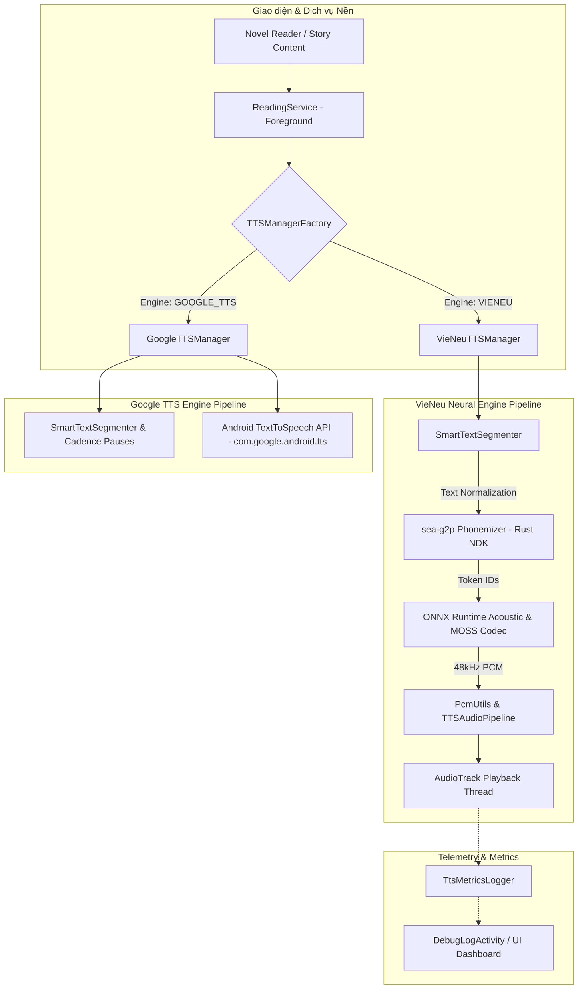

# 📖 DocTruyen & VieNeu-TTS - Ứng Dụng Đọc Truyện Offline AI Android

[-3DDC84?style=for-the-badge&logo=android&logoColor=white)](https://android.com)
[](https://kotlinlang.org/)
[](https://onnxruntime.ai/)
[-FF6F00?style=for-the-badge)](https://github.com/)

**DocTruyen** là ứng dụng đọc và nghe truyện tiếng Việt hiện đại dành cho Android, được tích hợp trực tiếp **VieNeu-TTS v3 Turbo** — mô hình AI Text-to-Speech tiếng Việt chất lượng cao chạy **100% Offline trên thiết bị (On-Device Inference)**.

Ứng dụng mang lại giọng đọc tự nhiên như người thật với khả năng ngắt nghỉ ngữ nghĩa thông minh, không cần kết nối mạng, không tốn chi phí máy chủ (0đ Server), và hoạt động mượt mà khi chạy ngầm hoặc tắt màn hình.

---

## 🌟 Điểm Nổi Bật

* 🧠 **100% Offline On-Device AI:** Toàn bộ quá trình chuyển văn bản thành giọng nói (G2P -> Acoustic Model -> Neural Codec -> 48kHz PCM Audio) diễn ra trực tiếp trên CPU điện thoại qua ONNX Runtime int8. Không gửi dữ liệu ra bên ngoài.
* 🎙️ **Giọng Đọc Tự Nhiên & Ngắt Nghỉ Ngữ Nghĩa:** Hệ thống phân đoạn văn bản thông minh (`SmartTextSegmenter`) phân tích dấu câu, câu thoại nhân vật, dấu ngoặc, liên từ và cấu trúc đoạn văn bản để tự động tạo nhịp thở và khoảng lặng tự nhiên.
* ⚡ **Độ Trễ Cực Thấp (Low TTFT & Gapless Playback):** Cơ chế Pipeline xử lý luồng âm thanh liên tục (`TTSAudioPipeline`) với pre-buffering giúp phát câu đầu tiên chỉ sau **~2.2 giây** và phát liền mạch không ngắt quãng giữa các câu/đoạn.
* 🔋 **Chạy Ẩn Tiết Kiệm Pin:** Hỗ trợ `Foreground Service` kết hợp `MediaSessionCompat` cho phép nghe truyện khi tắt màn hình hoặc chuyển sang ứng dụng khác, điều khiển trực tiếp trên thanh thông báo hoặc tai nghe Bluetooth.
* ⚙️ **Tùy Biến Nhịp Điệu (Cadence & Pause Settings):** Người dùng có thể tự do điều chỉnh thời gian ngắt nghỉ giữa các câu, dấu phẩy, đoạn văn và câu đối thoại theo sở thích.
* 📊 **Telemetry & Chẩn Đoán Thời Gian Thực:** Tích hợp bộ đo hiệu năng (`TtsMetricsLogger`) và màn hình log chuyên sâu (`DebugLogActivity`) theo dõi Real-Time Factor (RTF), Time-To-First-Track (TTFT), Buffer Underruns.

---

## 🏛️ Kiến Trúc Hệ Thống (Dual TTS Engine)

Hệ thống hỗ trợ chuyển đổi linh hoạt giữa **VieNeu Neural AI TTS** (On-Device Neural Model) và **Google TTS / Hệ Thống Android** thông qua interface thống nhất `ITTSManager` và `TTSManagerFactory`.



---

## 🎙️ Dual Engine: VieNeu AI & Google TTS

| Đặc tính | VieNeu Neural AI TTS | Google TTS Engine |
| :--- | :--- | :--- |
| **Loại mô hình** | On-Device Neural Codec + Acoustic Transformer | Android System TextToSpeech (`com.google.android.tts`) |
| **Chất lượng** | Giọng đọc tự nhiên, liền mạch, biểu cảm cao | Chuẩn ngữ điệu Google, tốc độ phản hồi cực nhanh |
| **Giọng đọc có sẵn** | 8 giọng (Trúc Ly, Minh Đức, Phạm Tuyên, Thái Sơn,...) | Toàn bộ giọng Google Tiếng Việt (Offline & Online) |
| **Cơ chế ngắt nghỉ** | Micro-fade & Atomic Chunk Silence theo ngữ nghĩa | SmartTextSegmenter silent utterance insertion |
| **Chuyển đổi tức thời** | Toggle 1-chạm trong Cài Đặt (đồng bộ `ReadingService`) | Toggle 1-chạm trong Cài Đặt (đồng bộ `ReadingService`) |

---

## 📊 Kết Quả Đo Đạc Thực Tế Trên Thiết Bị Hàng Ngày (Real-World Device)

Được ghi nhận trực tiếp từ telemetry telemetry engine (`TtsMetricsLogger`) trên thiết bị Android thực tế hàng ngày (Android 10 Mobile, đọc truyện *"Một trí khôn hơn trăm trí khôn"* - 19 chunks, 75.3s audio):

| Chỉ số (Metric) | Kết quả thực tế (Thiết bị hàng ngày) | Mức chuẩn mong muốn | Đánh giá & Hiện trạng |
| :--- | :--- | :--- | :--- |
| **Time To First Audio (TTFT)** | **5,009 ms** (~5.0s) | < 3,000 ms | ⚠️ **Hơi chậm ở câu đầu tiên** |
| **Mean Real-Time Factor (Avg RTF)** | **0.94x** (Có câu lên **1.01x**) | < 0.650x | ⚠️ **Tiệm cận 1.0x (CPU chạy 94.1% thời gian)** |
| **P90 Chunk Inference** | **6,805 ms – 7,511 ms** | < 2,500 ms | ⚠️ **Câu dài (~120 ký tự) mất ~7.5s xử lý** |
| **Tổng thời gian CPU chạy AI** | **70,828 ms / 75,280 ms** | Nghỉ > 50% | 🔴 **CPU chạy 94.1% liên tục $\rightarrow$ Gây nóng máy** |
| **Buffer Underruns / Khựng âm** | **1 lần** (Trễ 167ms ở Chunk #2) | 0 lần | ⚠️ **Cần tối ưu Pacing & Pre-buffering** |
| **Bộ nhớ RAM sử dụng (Peak RAM)** | **~520 MB** | < 800 MB | 🟢 **Ổn định, không leak RAM** |

> 💡 **Nhận xét & Khuyến nghị thực tế:** 
> - Trên các thiết bị tầm trung/thông dụng, mô hình AI VieNeu chạy liên tục trên CPU khiến máy bị ấm lên do tải tính toán cao (RTF ~0.94x).
> - Để máy luôn mát và tiết kiệm pin, người dùng có thể linh hoạt chuyển sang **Google TTS** trong Cài đặt (CPU < 2%, máy hoàn toàn mát lạnh).

---

## ⚙️ Các Module Cốt Lõi

### 1. `SmartTextSegmenter` (Phân Đoạn Tiếng Việt)
* Bảo vệ các từ viết tắt chuyên biệt tiếng Việt: `TP.HCM`, `BS.`, `TS.`, `GS.`, `ThS.`, `ThS.BS`, `Q.1`, v.v.
* Bảo vệ số thập phân, phân số, thời gian (`12:30`, `1.500.000đ`, `3.14`).
* Phân loại chính xác 5 kiểu ngắt nhịp:
  * `COMMA_CLAUSE`: Dấu phẩy, chấm phẩy, dấu gạch ngang (Mặc định: ~180ms).
  * `SENTENCE_MID`: Dấu chấm, chấm lửng, chấm than (Mặc định: ~320ms).
  * `SENTENCE_FINAL`: Kết thúc câu chuẩn (Mặc định: ~380ms).
  * `DIALOGUE_TURN`: Lời thoại nhân vật trong ngoặc kép `“...”` hoặc gạch đầu dòng (Mặc định: ~450ms).
  * `PARAGRAPH_BREAK`: Xuống dòng, chuyển phân đoạn (Mặc định: ~650ms).

### 2. `TTSAudioPipeline` & `PcmUtils` (Xử Lý Âm Thanh Liền Mạch)
* **Atomic Chunk Silence**: Ghép buffer âm thanh tổng hợp và khoảng lặng thành một mảng PCM duy nhất trước khi đưa vào AudioQueue, loại bỏ hoàn toàn hiện tượng false-alarm underrun giữa các câu.
* **Micro-Fade 5ms**: Áp dụng thuật toán fade-in / fade-out ở 2 đầu PCM để triệt tiêu tiếng click/pop tần số cao khi ngắt mở âm thanh.
* **Lookahead Dynamic Pre-buffering**: Duy trì bộ đệm từ 2 đến 3 câu trước khi bắt đầu phát, đảm bảo tốc độ tạo âm thanh luôn nhanh hơn tốc độ đọc của người nghe.

### 3. `ReadingService` & Media Notification
* Tích hợp `MediaSessionCompat` đồng bộ với Notification Android 13+ (hiển thị tiến trình, nút Play/Pause, tua đoạn).
* Tự động xử lý Audio Focus (tạm dừng khi có cuộc gọi đến, khôi phục âm lượng khi hết thông báo).

---

## 📱 Cấu Hình Yêu Cầu

* **Hệ điều hành**: Android 7.0 (API Level 24) trở lên (Khuyến nghị Android 10+).
* **Kiến trúc CPU**: `arm64-v8a` (hoặc `armeabi-v7a`, `x86_64`).
* **RAM khuyến nghị**: Tối thiểu 3GB RAM (App chiếm ~500-600MB khi chạy model AI).
* **Dung lượng trống**: ~350MB cho bộ mô hình ONNX và từ điển G2P.

---

## 🛠 Tech Stack & Kiến Trúc Công Nghệ Chuyên Sâu

DocTruyen được xây dựng với kiến trúc hybrid kết hợp giữa **Modern Android Development (MAD)** nguyên bản và **Hệ thống suy luận AI Neural On-Device (C++/Rust NDK + ONNX Runtime)** hiệu năng cao, tối ưu hóa triệt để cho môi trường di động giới hạn tài nguyên.

---

### 1. Nền Tảng Di Động & Hệ Thống Build (Android Core & Build System)
* **Ngôn ngữ phát triển:** [Kotlin 2.0.21](https://kotlinlang.org/) — Tận dụng Kotlin K2 Compiler mới nhất cho tốc độ biên dịch nhanh, tối ưu inline functions và lambda allocations.
* **Môi trường runtime & SDK:**
  * `compileSdk = 35` / `targetSdk = 35` (Android 15)
  * `minSdk = 24` (Android 7.0 Nougat trở lên, hỗ trợ tương thích ngược >95% thiết bị Android đang hoạt động)
  * `Java / JVM Target`: Java 11
* **Build System:** Gradle 8.9.0 với Android Gradle Plugin (AGP) 8.9.0 & Kotlin DSL (`build.gradle.kts`), quản lý thư viện tập trung qua Gradle Version Catalogs (`libs.versions.toml`).
* **Packaging & Asset Optimization:**
  * Khai báo `androidResources.noCompress += listOf("onnx", "data", "npz", "json")` nhằm nạp trực tiếp mô hình ONNX và weights vào bộ nhớ thông qua Memory Mapping (`mmap`), loại bỏ hoàn toàn độ trễ giải nén và tiết kiệm RAM lúc khởi động app.

---

### 2. Mô Hình AI & Hệ Thống Suy Luận Cốt Lõi (On-Device Neural TTS Engine)
Toàn bộ chu trình sinh âm thanh (Text -> Phonemes -> Acoustic Transformer -> Neural Audio Codec -> 48kHz PCM) chạy **100% Offline trên CPU điện thoại**:

* **Suy Luận Đa Luồng Nền Tảng (Inference Engine):**
  * **[Microsoft ONNX Runtime Android v1.20.0](https://onnxruntime.ai/):** Chạy trên Execution Provider đa luồng (CPU / XNNPACK) có hỗ trợ tăng tốc phần cứng NNAPI (`NNAPIFlags`).
  * **Hỗ trợ Đa Lượng Hóa (Quantization Aware):** Tự động nhận diện và xử lý linh hoạt các mô hình `INT8`, `FP16`, `FP32`.
* **Acoustic & Backbone Transformer:**
  * **VieNeu-TTS v3 Turbo:** Kiến trúc Autoregressive Transformer với KV-Caching:
    * `vieneu_prefill.onnx`: Khởi tạo KV-cache từ chuỗi token ngữ âm và prompt giọng đọc.
    * `vieneu_decode_step.onnx`: Sinh bước giải mã kế tiếp qua autoregressive loop với KV-cache tái sử dụng.
    * `vieneu_acoustic_cached.onnx`: Dự đoán đặc trưng âm học codebook.
    * `vieneu_v3_heads.npz`: Trích xuất và nạp nhanh các ma trận trọng số text/audio embeddings và projection heads qua trình đọc nhị phân tự xây dựng `NpzReader.kt`.
* **Neural Audio Codec (Neural Vocoder):**
  * **MOSS Audio Tokenizer Nano:**
    * `moss_audio_tokenizer_decode_full.onnx` & `moss_audio_tokenizer_decode_step.onnx` cùng file trọng số liên kết ngoài `moss_audio_tokenizer_decode_shared.data`.
    * Giải mã 16 kênh codebook lượng hóa véc-tơ (RVQ) thành chuỗi tín hiệu xung mã **48,000 Hz, 16-bit Mono PCM**.
* **Xử Lý Ngữ Âm Tiếng Việt (Phonemizer & Rust Native NDK):**
  * **`sea-g2p` (Southeast Asian Grapheme-to-Phoneme):** Nhân lõi chuyển đổi từ chữ viết tiếng Việt sang ký tự ngữ âm quốc tế (IPA).
  * Biên dịch từ **Rust** sang thư viện C-shared library (`libsea_g2p_android.so`) qua `cargo-ndk`, hỗ trợ 3 kiến trúc phần cứng chính:
    * `arm64-v8a` (Các dòng chip 64-bit hiện đại)
    * `armeabi-v7a` (Các dòng chip 32-bit cũ)
    * `x86_64` (Trình giả lập Android Emulator & Chromebooks)
  * Bộ nhớ đệm âm vị hai tầng: Tích hợp Thread-Safe Bounded LRU Cache 512 phần tử (`LinkedHashMap`) tại tầng Kotlin giúp triệt tiêu thời gian gọi JNI lặp lại trên các từ vựng phổ biến.

---

### 3. Thuật Toán Xử Lý Tín Hiệu Số & Chống Suy Thoái (DSP & Algorithmic Optimizations)
* **Trượt Cửa Sổ Phạt Lặp (Sliding-Window Repetition Penalty - `RepetitionHistory.kt`):**
  * Cơ chế Circular FIFO Buffer 64 khung hình (~2.5 giây âm thanh) trên toàn bộ 16 kênh codebook.
  * Bộ theo dõi tần suất $O(1)$ không cấp phát động (`zero-allocation`), giới hạn phạm vi phạt lặp trong cửa sổ trượt, triệt tiêu hoàn toàn hiện tượng lệch giọng (voice drift), biến âm hoặc giọng thì thầm trên các đoạn văn dài.
* **Phân Vùng Lấy Mẫu Siêu Tốc (QuickSelect Top-256 Sampling):**
  * Triển khai thuật toán Hoare QuickSelect in-place trên mảng 1024 logits, lọc top 256 ứng viên trước khi tính hàm Softmax, tăng tốc độ tính xác suất sinh mẫu ~1.5x mỗi bước decode.
* **Bộ Lọc Ảo Giác Câu Ngắn (BabbleGuard Anti-Hallucination - `BabbleGuard.kt`):**
  * Phân tích bao năng lượng RMS (Hop size 10ms ở 48kHz, ngưỡng `-24dB relative peak`).
  * Heuristic `isBabbleSuspect`: Nhận diện tiếng lầm bầm vô nghĩa, tạp âm dải biên hoặc lỗi sinh thừa trên câu thoại siêu ngắn (1–2 âm tiết như *"Ừ."*, *"Vâng."*).
  * Vòng lặp resynthesis tự động tối đa 2 lần với cơ chế đổi seed/nhiệt độ và bộ so khớp ứng viên tối ưu (`babblePrefer`).
* **Trích Xuất Thẻ Cảm Xúc & Phân Tách Chú Thích (`EmotionTagParser`):**
  * Ánh xạ chính xác các thẻ biểu cảm `[cười]`, `[thở dài]`, `[hắng giọng]` (và các biến thể tiếng Anh / không dấu) sang token đặc biệt `<|emotion_1|>`, `<|emotion_2|>`, `<|emotion_3|>` (token IDs 9, 10, 11).
  * Bộ phân tách RegEx bảo vệ dấu ngoặc vuông chú thích truyện (`[1]`, `[CV]`, `[Chương 2]`), bỏ qua Normalizer để không làm hỏng token ID.
* **Xử Lý PCM & Ghép Khoảng Lặng Nguyên Tử (`PcmUtils.kt`):**
  * **Atomic Chunk Silence:** Ghép nối buffer âm thanh đã sinh và khoảng lặng nhân tạo thành một mảng PCM duy nhất trước khi đẩy vào hàng đợi AudioQueue, loại trừ lỗi chập chờn khựng tiếng (false-alarm underruns).
  * **Micro-Fade (5ms):** Thuật toán làm mịn cạnh biên dốc tuyến tính (Linear Cosine/Ramp Fade) ở cả hai đầu mảng sóng âm nhằm khử hoàn toàn tiếng nổ lách tách (click/pop noise).

---

### 4. Kiến Trúc Phát Âm Thanh & Đa Nhiệm (Audio Streaming & Concurrency)
* **Xử Lý Bất Đồng Bộ Hiện Đại:**
  * **Kotlin Coroutines (`1.7.3`):** Quản lý luồng tính toán AI trên `Dispatchers.Default` và truyền phát âm thanh trên Worker Thread riêng biệt qua `SupervisorJob`.
  * **StateFlow, Channels & ConcurrentLinkedQueue:** Truyền nhận dữ liệu dạng stream liên tục giữa tầng sinh mẫu và tầng phát loa không gây khóa luồng giao diện (Lock-free UI).
* **Truyền Phát Âm Thanh Tần Số Cao:**
  * `android.media.AudioTrack` cấu hình ở chế độ `MODE_STREAM`, `AudioFormat.ENCODING_PCM_16BIT`, `AudioFormat.CHANNEL_OUT_MONO`, tần số mẫu `48,000 Hz`.
  * Bộ đệm tương thích `minPreBufferChunks = 2` kết hợp cơ chế đọc trước động (Lookahead Pre-buffering).
* **Quản Lý Phiên Âm Thanh & Chạy Nền Bền Bỉ:**
  * **Foreground Service (`ReadingService`):** Đảm bảo tiến trình đọc không bị hệ điều hành tiêu diệt khi chạy ngầm hoặc khóa màn hình.
  * **WakeLock Management:** Tự động giữ CPU hoạt động với cơ chế quản lý an toàn tránh rò rỉ pin (`IWakeLock` wrapper).
  * **MediaSessionCompat & NotificationCompat (AndroidX Media 1.7.0):** Tích hợp trình điều khiển đa phương tiện toàn hệ thống, hỗ trợ thanh điều khiển trên màn hình khóa, Notification Android 13+ và phản hồi sự kiện tai nghe Bluetooth (Audio Focus change, Noisy intent).

---

### 5. Giao Diện Người Dùng & Thư Viện Mở Rộng (UI/UX & Networking)
* **Giao Diện (UI Layer):**
  * **Google Material Design 3 (`1.12.0`) & AppCompat (`1.7.0`):** Hệ thống giao diện hiện đại, bo góc mềm mại, hỗ trợ Dark Mode hoàn chỉnh.
  * **ConstraintLayout (`2.1.4`), RecyclerView (`1.3.2`) & SwipeRefreshLayout (`1.1.0`):** Danh sách truyện mượt mà, tải dữ liệu kéo-để-làm-mới.
  * **AndroidX Activity KTX (`1.9.3`) & Lifecycle Runtime/ViewModel (`2.7.0`):** Kiến trúc phân tách rõ ràng vòng đời Activity và Service.
* **Tải Ảnh & Quản Trị Mạng (Networking & Media Loading):**
  * **[Retrofit 2 (`2.9.0`)](https://square.github.io/retrofit/) + [OkHttp 3 (`4.12.0`)](https://square.github.io/okhttp/):** RESTful API Client, xử lý JSON thông qua `converter-gson`.
  * **OkHttp Logging Interceptor:** Hỗ trợ kiểm tra và ghi vết request/response khi debug.
  * **[Bumptech Glide (`4.16.0`)](https://github.com/bumptech/glide):** Tải ảnh bìa truyện bất đồng bộ, bộ nhớ đệm cache 2 lớp (Disk + Memory), tự động resize kích thước tối ưu bộ nhớ.

---

### 6. Giám Sát, Chẩn Đoán & Kiểm Thử (Telemetry, Diagnostics & Testing)
* **Engine Đo Đạc Thời Gian Thực (`TtsMetricsLogger.kt`):**
  * Theo dõi chi tiết từng mẩu câu (chunk): thời gian chuyển đổi ngữ âm (G2P), thời gian chạy ONNX Backbone, thời gian chạy Codec, Real-Time Factor (RTF), Time-To-First-Track (TTFT), số lần Starvation/Underrun.
  * Công cụ chẩn đoán AI cục bộ (`AiDiagnosticFlag`): Tự động phát hiện bất thường về tốc độ giải mã hoặc nghẽn hàng đợi âm thanh.
* **Màn Hình Chẩn Đoán Chuyên Dụng (`DebugLogActivity.kt`):**
  * Dashboard hiển thị biểu đồ và chỉ số hiệu năng theo thời gian thực trực tiếp trên màn hình điện thoại.
* **Kiểm Thử Đa Tầng (Unit & Instrumented Testing):**
  * **JUnit 4 (`4.13.2`) + ONNX Runtime Desktop (`1.20.0`):** Kiểm thử logic phân đoạn câu, vòng lặp chống lặp, tách biểu cảm và mô phỏng suy luận ngay trên máy tính mà không cần kết nối điện thoại (`testImplementation`).
  * **AndroidX Test Runner & Espresso Core (`3.6.1`):** Kiểm thử luồng tích hợp trên phần cứng thiết bị thật (`connectedAndroidTest`).

---

## 📂 Cấu Trúc Thư Mục Dự Án

```
DocTruyenApk-main/
├── app/
│   ├── src/
│   │   ├── main/
│   │   │   ├── assets/vieneu/              # Mô hình ONNX, tokenizer & acoustic heads
│   │   │   │   ├── backbone/               # ONNX prefill/decode/acoustic/shared weights
│   │   │   │   ├── denoiser.onnx
│   │   │   │   └── sea_g2p.bin             # Từ điển ngữ âm tiếng Việt
│   │   │   ├── jniLibs/                    # Native .so libraries (libsea_g2p.so)
│   │   │   ├── java/com/skul9x/doctruyen/
│   │   │   │   ├── tts/vieneu/             # Engine VieNeu-TTS & Audio Pipeline
│   │   │   │   │   ├── SmartTextSegmenter.kt    # Bộ tách câu, đoạn, ngữ nghĩa
│   │   │   │   │   ├── TTSAudioPipeline.kt      # Quản lý hàng đợi & AudioTrack
│   │   │   │   │   ├── PcmUtils.kt              # Xử lý PCM, micro-fade, khoảng lặng
│   │   │   │   │   ├── VieNeuTTSManager.kt      # Điều phối ONNX + Phonemizer
│   │   │   │   │   └── TtsMetricsLogger.kt      # Ghi nhận chỉ số TTFT, RTF, Underrun
│   │   │   │   ├── services/
│   │   │   │   │   └── ReadingService.kt        # Foreground Service phát âm thanh
│   │   │   │   ├── SettingsActivity.kt          # Màn hình cài đặt giọng đọc & ngắt nghỉ
│   │   │   │   └── DebugLogActivity.kt          # Màn hình xem telemetry & chẩn đoán
│   │   │   └── res/                             # Layouts, themes, drawables, strings
│   │   ├── test/                                # Unit Tests (JVM)
│   │   └── androidTest/                         # On-Device Hardware Tests
├── plans/                                  # Kế hoạch phát triển & báo cáo benchmark
└── README.md
```

---

## 🚀 Hướng Dẫn Cài Đặt & Biên Dịch (Build Guide)

### 1. Clone Source Code
```bash
git clone https://github.com/skul9x/DocTruyenApk.git
cd DocTruyenApk
```

### 2. Tải và Đặt Assets Mô Hình AI
Đảm bảo các file mô hình ONNX được đặt chính xác tại thư mục `app/src/main/assets/vieneu/`:
* `backbone/vieneu_prefill.onnx`
* `backbone/vieneu_decode_step.onnx`
* `backbone/vieneu_acoustic_cached.onnx`
* `backbone/vieneu_backbone_shared.data`
* `backbone/vieneu_v3_heads.npz`
* `backbone/moss_audio_tokenizer_decode_full.onnx`
* `backbone/moss_audio_tokenizer_decode_shared.data`
* `backbone/moss_audio_tokenizer_decode_step.onnx`
* `denoiser.onnx`
* `sea_g2p.bin`

### 3. Build & Run
1. Mở dự án bằng **Android Studio Ladybug (hoặc mới hơn)**.
2. Đợi Gradle Sync hoàn tất các dependencies.
3. Kết nối điện thoại Android (bật USB Debugging) hoặc khởi chạy máy ảo.
4. Chạy lệnh build hoặc nhấn nút **Run** (Shift + F10):
   ```bash
   ./gradlew assembleDebug
   ```

### 4. Chạy Kiểm Thử On-Device Benchmark
Để kiểm tra hiệu năng thực tế trên thiết bị kết nối qua ADB:
```bash
./gradlew connectedAndroidTest -Pandroid.testInstrumentationRunnerArguments.class=com.skul9x.doctruyen.tts.vieneu.TTSNaturalReadingDeviceTest
```

---

## ⚙️ Cấu Hình Tùy Chỉnh Giọng Đọc

Trong ứng dụng, vào mục **Cài đặt (Settings)** -> **Cấu hình TTS VieNeu**:

| Tùy chọn | Mô tả | Mặc định |
| :--- | :--- | :--- |
| **Khoảng dừng dấu phẩy** | Khoảng lặng giữa các vế câu ngắn (` , ; - `) | `180 ms` |
| **Khoảng dừng kết thúc câu** | Khoảng lặng sau dấu chấm câu (` . ! ? ... `) | `380 ms` |
| **Khoảng dừng chuyển đoạn** | Khoảng lặng khi kết thúc một đoạn văn | `650 ms` |
| **Khoảng dừng hội thoại** | Khoảng lặng trước/sau câu thoại nhân vật | `450 ms` |
| **Xem Telemetry / Log** | Mở màn hình Debug Log chẩn đoán hiệu năng | Bật / Tắt |

---

## 🤝 Đóng Góp & Phát Triển

Mọi ý kiến đóng góp, pull request hoặc báo lỗi (issue) đều được hoan nghênh. Dự án được xây dựng với mục tiêu mang AI giọng đọc tự nhiên mã nguồn mở đến mọi thiết bị Android di động.

---

## 📄 Bản Quyền & Giấy Phép

* Ứng dụng DocTruyen phát triển bởi **skul9x**.
* VieNeu-TTS Engine & Models: Thuộc bản quyền của dự án VieNeu-TTS.
