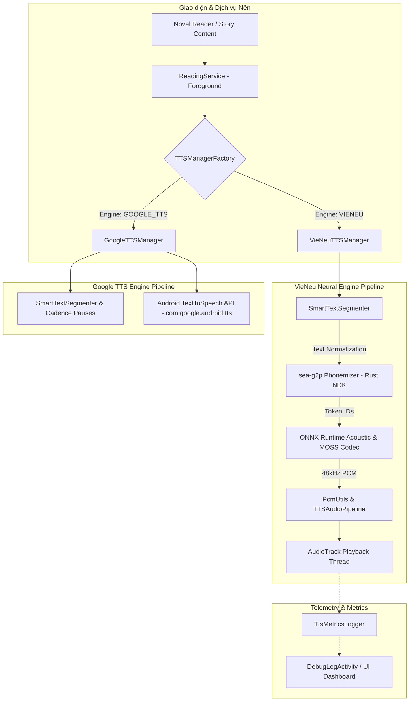

# 📖 DocTruyen & VieNeu-TTS - Ứng Dụng Đọc Truyện Offline AI Android

[-3DDC84?style=for-the-badge&logo=android&logoColor=white)](https://android.com)
[](https://kotlinlang.org/)
[](https://onnxruntime.ai/)
[-FF6F00?style=for-the-badge)](https://github.com/)

**DocTruyen** là ứng dụng đọc và nghe truyện tiếng Việt hiện đại dành cho Android, được tích hợp trực tiếp **VieNeu-TTS v3 Turbo** — mô hình AI Text-to-Speech tiếng Việt chất lượng cao chạy **100% Offline trên thiết bị (On-Device Inference)**.

Ứng dụng mang lại giọng đọc tự nhiên như người thật với khả năng ngắt nghỉ ngữ nghĩa thông minh, không cần kết nối mạng, không tốn chi phí máy chủ (0đ Server), và hoạt động mượt mà khi chạy ngầm hoặc tắt màn hình.

---

## 🌟 Điểm Nổi Bật

* 🧠 **100% Offline On-Device AI:** Toàn bộ quá trình chuyển văn bản thành giọng nói (G2P -> Acoustic Model -> Neural Codec -> 48kHz PCM Audio) diễn ra trực tiếp trên CPU điện thoại qua ONNX Runtime int8. Không gửi dữ liệu ra bên ngoài.
* 🎙️ **Giọng Đọc Tự Nhiên & Ngắt Nghỉ Ngữ Nghĩa:** Hệ thống phân đoạn văn bản thông minh (`SmartTextSegmenter`) phân tích dấu câu, câu thoại nhân vật, dấu ngoặc, liên từ và cấu trúc đoạn văn bản để tự động tạo nhịp thở và khoảng lặng tự nhiên.
* ⚡ **Độ Trễ Cực Thấp (Low TTFT & Gapless Playback):** Cơ chế Pipeline xử lý luồng âm thanh liên tục (`TTSAudioPipeline`) với pre-buffering giúp phát câu đầu tiên chỉ sau **~2.2 giây** và phát liền mạch không ngắt quãng giữa các câu/đoạn.
* 🔋 **Chạy Ẩn Tiết Kiệm Pin:** Hỗ trợ `Foreground Service` kết hợp `MediaSessionCompat` cho phép nghe truyện khi tắt màn hình hoặc chuyển sang ứng dụng khác, điều khiển trực tiếp trên thanh thông báo hoặc tai nghe Bluetooth.
* ⚙️ **Tùy Biến Nhịp Điệu (Cadence & Pause Settings):** Người dùng có thể tự do điều chỉnh thời gian ngắt nghỉ giữa các câu, dấu phẩy, đoạn văn và câu đối thoại theo sở thích.
* 📊 **Telemetry & Chẩn Đoán Thời Gian Thực:** Tích hợp bộ đo hiệu năng (`TtsMetricsLogger`) và màn hình log chuyên sâu (`DebugLogActivity`) theo dõi Real-Time Factor (RTF), Time-To-First-Track (TTFT), Buffer Underruns.

---

## 🏛️ Kiến Trúc Hệ Thống (Dual TTS Engine)

Hệ thống hỗ trợ chuyển đổi linh hoạt giữa **VieNeu Neural AI TTS** (On-Device Neural Model) và **Google TTS / Hệ Thống Android** thông qua interface thống nhất `ITTSManager` và `TTSManagerFactory`.



---

## 🎙️ Dual Engine: VieNeu AI & Google TTS

| Đặc tính | VieNeu Neural AI TTS | Google TTS Engine |
| :--- | :--- | :--- |
| **Loại mô hình** | On-Device Neural Codec + Acoustic Transformer | Android System TextToSpeech (`com.google.android.tts`) |
| **Chất lượng** | Giọng đọc tự nhiên, liền mạch, biểu cảm cao | Chuẩn ngữ điệu Google, tốc độ phản hồi cực nhanh |
| **Giọng đọc có sẵn** | 8 giọng (Trúc Ly, Minh Đức, Phạm Tuyên, Thái Sơn,...) | Toàn bộ giọng Google Tiếng Việt (Offline & Online) |
| **Cơ chế ngắt nghỉ** | Micro-fade & Atomic Chunk Silence theo ngữ nghĩa | SmartTextSegmenter silent utterance insertion |
| **Chuyển đổi tức thời** | Toggle 1-chạm trong Cài Đặt (đồng bộ `ReadingService`) | Toggle 1-chạm trong Cài Đặt (đồng bộ `ReadingService`) |

---

## 📊 Kết Quả Benchmark Trên Thiết Bị Thật (Physical Device)

Được đo đạc thực tế trên thiết bị Android vật lý (Android 15, ARM64-v8a) qua test suite `TTSNaturalReadingDeviceTest`:

| Chỉ số (Metric) | Kết quả thực tế | Mục tiêu thiết kế | Đánh giá |
| :--- | :--- | :--- | :--- |
| **Time To First Track (TTFT)** | **2,242 ms** | < 3,000 ms | 🟢 **Xuất sắc (Đạt)** |
| **Mean Real-Time Factor (RTF)** | **0.443x** | < 0.650x | 🟢 **Nhanh hơn thời gian thực 2.25x** |
| **Buffer Underruns / Giật lag** | **0 lần** | 0 lần | 🟢 **Mượt mà hoàn toàn** |
| **P90 Chunk Inference** | **1,812 ms** | < 2,500 ms | 🟢 **Đạt chuẩn** |
| **Bộ nhớ RAM sử dụng (Peak RAM)** | **~520 MB** | < 800 MB | 🟢 **Ổn định, không leak** |

---

## ⚙️ Các Module Cốt Lõi

### 1. `SmartTextSegmenter` (Phân Đoạn Tiếng Việt)
* Bảo vệ các từ viết tắt chuyên biệt tiếng Việt: `TP.HCM`, `BS.`, `TS.`, `GS.`, `ThS.`, `ThS.BS`, `Q.1`, v.v.
* Bảo vệ số thập phân, phân số, thời gian (`12:30`, `1.500.000đ`, `3.14`).
* Phân loại chính xác 5 kiểu ngắt nhịp:
  * `COMMA_CLAUSE`: Dấu phẩy, chấm phẩy, dấu gạch ngang (Mặc định: ~180ms).
  * `SENTENCE_MID`: Dấu chấm, chấm lửng, chấm than (Mặc định: ~320ms).
  * `SENTENCE_FINAL`: Kết thúc câu chuẩn (Mặc định: ~380ms).
  * `DIALOGUE_TURN`: Lời thoại nhân vật trong ngoặc kép `“...”` hoặc gạch đầu dòng (Mặc định: ~450ms).
  * `PARAGRAPH_BREAK`: Xuống dòng, chuyển phân đoạn (Mặc định: ~650ms).

### 2. `TTSAudioPipeline` & `PcmUtils` (Xử Lý Âm Thanh Liền Mạch)
* **Atomic Chunk Silence**: Ghép buffer âm thanh tổng hợp và khoảng lặng thành một mảng PCM duy nhất trước khi đưa vào AudioQueue, loại bỏ hoàn toàn hiện tượng false-alarm underrun giữa các câu.
* **Micro-Fade 5ms**: Áp dụng thuật toán fade-in / fade-out ở 2 đầu PCM để triệt tiêu tiếng click/pop tần số cao khi ngắt mở âm thanh.
* **Lookahead Dynamic Pre-buffering**: Duy trì bộ đệm từ 2 đến 3 câu trước khi bắt đầu phát, đảm bảo tốc độ tạo âm thanh luôn nhanh hơn tốc độ đọc của người nghe.

### 3. `ReadingService` & Media Notification
* Tích hợp `MediaSessionCompat` đồng bộ với Notification Android 13+ (hiển thị tiến trình, nút Play/Pause, tua đoạn).
* Tự động xử lý Audio Focus (tạm dừng khi có cuộc gọi đến, khôi phục âm lượng khi hết thông báo).

---

## 📱 Cấu Hình Yêu Cầu

* **Hệ điều hành**: Android 7.0 (API Level 24) trở lên (Khuyến nghị Android 10+).
* **Kiến trúc CPU**: `arm64-v8a` (hoặc `armeabi-v7a`, `x86_64`).
* **RAM khuyến nghị**: Tối thiểu 3GB RAM (App chiếm ~500-600MB khi chạy model AI).
* **Dung lượng trống**: ~350MB cho bộ mô hình ONNX và từ điển G2P.

---

## 🛠 Tech Stack & Thư Viện Sử Dụng

* **Ngôn ngữ:** [Kotlin 2.x](https://kotlinlang.org/)
* **AI & Inference:**
  * [Microsoft ONNX Runtime Android (v1.20.0)](https://onnxruntime.ai/)
  * `sea-g2p` (Vietnamese Phonemizer biên dịch từ Rust qua Cargo-NDK)
  * Mô hình `VieNeu-TTS v3 Turbo` (int8 quantized) + `MOSS Codec Nano`
* **Xử lý bất đồng bộ:** Kotlin Coroutines, Channels, StateFlow
* **Phát âm thanh:** `android.media.AudioTrack` (48,000 Hz, 16-bit PCM, Mono)
* **Networking & UI:**
  * [Retrofit 2](https://square.github.io/retrofit/) & [OkHttp 3](https://square.github.io/okhttp/)
  * [Glide 4.x](https://github.com/bumptech/glide)
  * AndroidX Media, Material Design 3

---

## 📂 Cấu Trúc Thư Mục Dự Án

```
DocTruyenApk-main/
├── app/
│   ├── src/
│   │   ├── main/
│   │   │   ├── assets/vieneu/              # Mô hình ONNX, tokenizer & acoustic heads
│   │   │   │   ├── backbone/               # ONNX prefill/decode/acoustic/shared weights
│   │   │   │   ├── denoiser.onnx
│   │   │   │   └── sea_g2p.bin             # Từ điển ngữ âm tiếng Việt
│   │   │   ├── jniLibs/                    # Native .so libraries (libsea_g2p.so)
│   │   │   ├── java/com/skul9x/doctruyen/
│   │   │   │   ├── tts/vieneu/             # Engine VieNeu-TTS & Audio Pipeline
│   │   │   │   │   ├── SmartTextSegmenter.kt    # Bộ tách câu, đoạn, ngữ nghĩa
│   │   │   │   │   ├── TTSAudioPipeline.kt      # Quản lý hàng đợi & AudioTrack
│   │   │   │   │   ├── PcmUtils.kt              # Xử lý PCM, micro-fade, khoảng lặng
│   │   │   │   │   ├── VieNeuTTSManager.kt      # Điều phối ONNX + Phonemizer
│   │   │   │   │   └── TtsMetricsLogger.kt      # Ghi nhận chỉ số TTFT, RTF, Underrun
│   │   │   │   ├── services/
│   │   │   │   │   └── ReadingService.kt        # Foreground Service phát âm thanh
│   │   │   │   ├── SettingsActivity.kt          # Màn hình cài đặt giọng đọc & ngắt nghỉ
│   │   │   │   └── DebugLogActivity.kt          # Màn hình xem telemetry & chẩn đoán
│   │   │   └── res/                             # Layouts, themes, drawables, strings
│   │   ├── test/                                # Unit Tests (JVM)
│   │   └── androidTest/                         # On-Device Hardware Tests
├── plans/                                  # Kế hoạch phát triển & báo cáo benchmark
└── README.md
```

---

## 🚀 Hướng Dẫn Cài Đặt & Biên Dịch (Build Guide)

### 1. Clone Source Code
```bash
git clone https://github.com/skul9x/DocTruyenApk.git
cd DocTruyenApk
```

### 2. Tải và Đặt Assets Mô Hình AI
Đảm bảo các file mô hình ONNX được đặt chính xác tại thư mục `app/src/main/assets/vieneu/`:
* `backbone/vieneu_prefill.onnx`
* `backbone/vieneu_decode_step.onnx`
* `backbone/vieneu_acoustic_cached.onnx`
* `backbone/vieneu_backbone_shared.data`
* `backbone/vieneu_v3_heads.npz`
* `backbone/moss_audio_tokenizer_decode_full.onnx`
* `backbone/moss_audio_tokenizer_decode_shared.data`
* `backbone/moss_audio_tokenizer_decode_step.onnx`
* `denoiser.onnx`
* `sea_g2p.bin`

### 3. Build & Run
1. Mở dự án bằng **Android Studio Ladybug (hoặc mới hơn)**.
2. Đợi Gradle Sync hoàn tất các dependencies.
3. Kết nối điện thoại Android (bật USB Debugging) hoặc khởi chạy máy ảo.
4. Chạy lệnh build hoặc nhấn nút **Run** (Shift + F10):
   ```bash
   ./gradlew assembleDebug
   ```

### 4. Chạy Kiểm Thử On-Device Benchmark
Để kiểm tra hiệu năng thực tế trên thiết bị kết nối qua ADB:
```bash
./gradlew connectedAndroidTest -Pandroid.testInstrumentationRunnerArguments.class=com.skul9x.doctruyen.tts.vieneu.TTSNaturalReadingDeviceTest
```

---

## ⚙️ Cấu Hình Tùy Chỉnh Giọng Đọc

Trong ứng dụng, vào mục **Cài đặt (Settings)** -> **Cấu hình TTS VieNeu**:

| Tùy chọn | Mô tả | Mặc định |
| :--- | :--- | :--- |
| **Khoảng dừng dấu phẩy** | Khoảng lặng giữa các vế câu ngắn (` , ; - `) | `180 ms` |
| **Khoảng dừng kết thúc câu** | Khoảng lặng sau dấu chấm câu (` . ! ? ... `) | `380 ms` |
| **Khoảng dừng chuyển đoạn** | Khoảng lặng khi kết thúc một đoạn văn | `650 ms` |
| **Khoảng dừng hội thoại** | Khoảng lặng trước/sau câu thoại nhân vật | `450 ms` |
| **Xem Telemetry / Log** | Mở màn hình Debug Log chẩn đoán hiệu năng | Bật / Tắt |

---

## 🤝 Đóng Góp & Phát Triển

Mọi ý kiến đóng góp, pull request hoặc báo lỗi (issue) đều được hoan nghênh. Dự án được xây dựng với mục tiêu mang AI giọng đọc tự nhiên mã nguồn mở đến mọi thiết bị Android di động.

---

## 📄 Bản Quyền & Giấy Phép

* Ứng dụng DocTruyen phát triển bởi **skul9x**.
* VieNeu-TTS Engine & Models: Thuộc bản quyền của dự án VieNeu-TTS.
