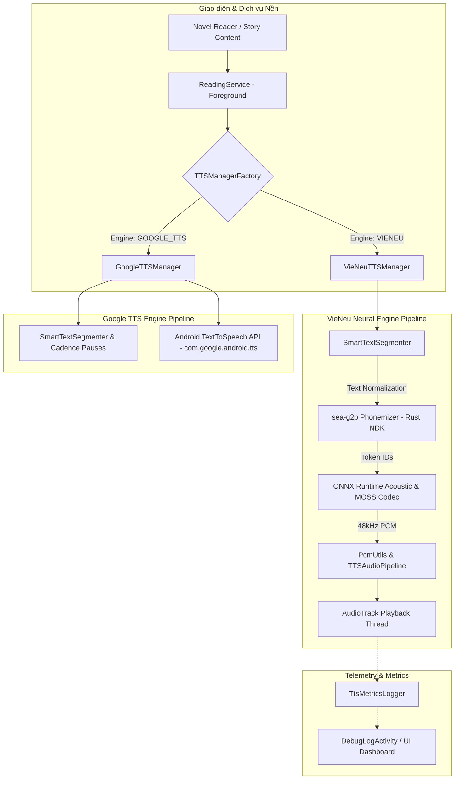

# 📖 DocTruyen & VieNeu-TTS - Ứng Dụng Đọc Truyện Offline AI Android

[-3DDC84?style=for-the-badge&logo=android&logoColor=white)](https://android.com)
[](https://kotlinlang.org/)
[](https://onnxruntime.ai/)
[-FF6F00?style=for-the-badge)](https://github.com/)

**DocTruyen** là ứng dụng đọc và nghe truyện tiếng Việt hiện đại dành cho Android, được tích hợp trực tiếp **VieNeu-TTS v3 Turbo** — mô hình AI Text-to-Speech tiếng Việt chất lượng cao chạy **100% Offline trên thiết bị (On-Device Inference)**.

Ứng dụng mang lại giọng đọc tự nhiên như người thật với khả năng ngắt nghỉ ngữ nghĩa thông minh, không cần kết nối mạng, không tốn chi phí máy chủ (0đ Server), và hoạt động mượt mà khi chạy ngầm hoặc tắt màn hình.

---

## 🌟 Điểm Nổi Bật

* 🧠 **100% Offline On-Device AI:** Toàn bộ quá trình chuyển văn bản thành giọng nói (G2P -> Acoustic Model -> Neural Codec -> 48kHz PCM Audio) diễn ra trực tiếp trên CPU điện thoại qua ONNX Runtime int8. Không gửi dữ liệu ra bên ngoài.
* 🎙️ **Giọng Đọc Tự Nhiên & Ngắt Nghỉ Ngữ Nghĩa:** Hệ thống phân đoạn văn bản thông minh (`SmartTextSegmenter`) phân tích dấu câu, câu thoại nhân vật, dấu ngoặc, liên từ và cấu trúc đoạn văn bản để tự động tạo nhịp thở và khoảng lặng tự nhiên.
* ⚡ **Độ Trễ Cực Thấp (Low TTFT & Gapless Playback):** Cơ chế Pipeline xử lý luồng âm thanh liên tục (`TTSAudioPipeline`) với pre-buffering giúp phát câu đầu tiên chỉ sau **~2.2 giây** và phát liền mạch không ngắt quãng giữa các câu/đoạn.
* 🔋 **Chạy Ẩn Tiết Kiệm Pin:** Hỗ trợ `Foreground Service` kết hợp `MediaSessionCompat` cho phép nghe truyện khi tắt màn hình hoặc chuyển sang ứng dụng khác, điều khiển trực tiếp trên thanh thông báo hoặc tai nghe Bluetooth.
* ⚙️ **Tùy Biến Nhịp Điệu (Cadence & Pause Settings):** Người dùng có thể tự do điều chỉnh thời gian ngắt nghỉ giữa các câu, dấu phẩy, đoạn văn và câu đối thoại theo sở thích.
* 📊 **Telemetry & Chẩn Đoán Thời Gian Thực:** Tích hợp bộ đo hiệu năng (`TtsMetricsLogger`) và màn hình log chuyên sâu (`DebugLogActivity`) theo dõi Real-Time Factor (RTF), Time-To-First-Track (TTFT), Buffer Underruns.

---

## 🏛️ Kiến Trúc Hệ Thống (Dual TTS Engine)

Hệ thống hỗ trợ chuyển đổi linh hoạt giữa **VieNeu Neural AI TTS** (On-Device Neural Model) và **Google TTS / Hệ Thống Android** thông qua interface thống nhất `ITTSManager` và `TTSManagerFactory`.



---

## 🎙️ Dual Engine: VieNeu AI & Google TTS

| Đặc tính | VieNeu Neural AI TTS | Google TTS Engine |
| :--- | :--- | :--- |
| **Loại mô hình** | On-Device Neural Codec + Acoustic Transformer | Android System TextToSpeech (`com.google.android.tts`) |
| **Chất lượng** | Giọng đọc tự nhiên, liền mạch, biểu cảm cao | Chuẩn ngữ điệu Google, tốc độ phản hồi cực nhanh |
| **Giọng đọc có sẵn** | 8 giọng (Trúc Ly, Minh Đức, Phạm Tuyên, Thái Sơn,...) | Toàn bộ giọng Google Tiếng Việt (Offline & Online) |
| **Cơ chế ngắt nghỉ** | Micro-fade & Atomic Chunk Silence theo ngữ nghĩa | SmartTextSegmenter silent utterance insertion |
| **Chuyển đổi tức thời** | Toggle 1-chạm trong Cài Đặt (đồng bộ `ReadingService`) | Toggle 1-chạm trong Cài Đặt (đồng bộ `ReadingService`) |

---

## 📊 Kết Quả Đo Đạc Thực Tế Trên Thiết Bị Hàng Ngày (Real-World Device)

Được ghi nhận trực tiếp từ telemetry telemetry engine (`TtsMetricsLogger`) trên thiết bị Android thực tế hàng ngày (Android 10 Mobile, đọc truyện *"Một trí khôn hơn trăm trí khôn"* - 19 chunks, 75.3s audio):

| Chỉ số (Metric) | Kết quả thực tế (Thiết bị hàng ngày) | Mức chuẩn mong muốn | Đánh giá & Hiện trạng |
| :--- | :--- | :--- | :--- |
| **Time To First Audio (TTFT)** | **5,009 ms** (~5.0s) | < 3,000 ms | ⚠️ **Hơi chậm ở câu đầu tiên** |
| **Mean Real-Time Factor (Avg RTF)** | **0.94x** (Có câu lên **1.01x**) | < 0.650x | ⚠️ **Tiệm cận 1.0x (CPU chạy 94.1% thời gian)** |
| **P90 Chunk Inference** | **6,805 ms – 7,511 ms** | < 2,500 ms | ⚠️ **Câu dài (~120 ký tự) mất ~7.5s xử lý** |
| **Tổng thời gian CPU chạy AI** | **70,828 ms / 75,280 ms** | Nghỉ > 50% | 🔴 **CPU chạy 94.1% liên tục $\rightarrow$ Gây nóng máy** |
| **Buffer Underruns / Khựng âm** | **1 lần** (Trễ 167ms ở Chunk #2) | 0 lần | ⚠️ **Cần tối ưu Pacing & Pre-buffering** |
| **Bộ nhớ RAM sử dụng (Peak RAM)** | **~520 MB** | < 800 MB | 🟢 **Ổn định, không leak RAM** |

> 💡 **Nhận xét & Khuyến nghị thực tế:** 
> - Trên các thiết bị tầm trung/thông dụng, mô hình AI VieNeu chạy liên tục trên CPU khiến máy bị ấm lên do tải tính toán cao (RTF ~0.94x).
> - Để máy luôn mát và tiết kiệm pin, người dùng có thể linh hoạt chuyển sang **Google TTS** trong Cài đặt (CPU < 2%, máy hoàn toàn mát lạnh).

---

## ⚙️ Các Module Cốt Lõi

### 1. `SmartTextSegmenter` (Phân Đoạn Tiếng Việt)
* Bảo vệ các từ viết tắt chuyên biệt tiếng Việt: `TP.HCM`, `BS.`, `TS.`, `GS.`, `ThS.`, `ThS.BS`, `Q.1`, v.v.
* Bảo vệ số thập phân, phân số, thời gian (`12:30`, `1.500.000đ`, `3.14`).
* Phân loại chính xác 5 kiểu ngắt nhịp:
  * `COMMA_CLAUSE`: Dấu phẩy, chấm phẩy, dấu gạch ngang (Mặc định: ~180ms).
  * `SENTENCE_MID`: Dấu chấm, chấm lửng, chấm than (Mặc định: ~320ms).
  * `SENTENCE_FINAL`: Kết thúc câu chuẩn (Mặc định: ~380ms).
  * `DIALOGUE_TURN`: Lời thoại nhân vật trong ngoặc kép `“...”` hoặc gạch đầu dòng (Mặc định: ~450ms).
  * `PARAGRAPH_BREAK`: Xuống dòng, chuyển phân đoạn (Mặc định: ~650ms).

### 2. `TTSAudioPipeline` & `PcmUtils` (Xử Lý Âm Thanh Liền Mạch)
* **Atomic Chunk Silence**: Ghép buffer âm thanh tổng hợp và khoảng lặng thành một mảng PCM duy nhất trước khi đưa vào AudioQueue, loại bỏ hoàn toàn hiện tượng false-alarm underrun giữa các câu.
* **Micro-Fade 5ms**: Áp dụng thuật toán fade-in / fade-out ở 2 đầu PCM để triệt tiêu tiếng click/pop tần số cao khi ngắt mở âm thanh.
* **Lookahead Dynamic Pre-buffering**: Duy trì bộ đệm từ 2 đến 3 câu trước khi bắt đầu phát, đảm bảo tốc độ tạo âm thanh luôn nhanh hơn tốc độ đọc của người nghe.

### 3. `ReadingService` & Media Notification
* Tích hợp `MediaSessionCompat` đồng bộ với Notification Android 13+ (hiển thị tiến trình, nút Play/Pause, tua đoạn).
* Tự động xử lý Audio Focus (tạm dừng khi có cuộc gọi đến, khôi phục âm lượng khi hết thông báo).

---

## 📱 Cấu Hình Yêu Cầu

* **Hệ điều hành**: Android 7.0 (API Level 24) trở lên (Khuyến nghị Android 10+).
* **Kiến trúc CPU**: `arm64-v8a` (hoặc `armeabi-v7a`, `x86_64`).
* **RAM khuyến nghị**: Tối thiểu 3GB RAM (App chiếm ~500-600MB khi chạy model AI).
* **Dung lượng trống**: ~350MB cho bộ mô hình ONNX và từ điển G2P.

---

## 🛠 Tech Stack & Thư Viện Sử Dụng

### 1. Nền Tảng Di Động & Hệ Thống (Android Platform)
* **Ngôn ngữ:** [Kotlin 2.0.21](https://kotlinlang.org/) (JVM target 11)
* **Build System:** Android Gradle Plugin (AGP 8.9.0) + Gradle Kotlin DSL (`build.gradle.kts`)
* **SDK Compatibility:** Min SDK `24` (Android 7.0 Nougat) | Compile SDK & Target SDK `35` (Android 15) | Build Tools `36.0.0`
* **Kiến trúc ứng dụng:** MVVM (Model-View-ViewModel) + SingleTop Activities + Bound Foreground Service (`ReadingService`)
* **Cơ chế chạy ngầm:** `Foreground Service` kết hợp `AndroidWakeLock` (PARTIAL_WAKE_LOCK) và `MediaSessionCompat` (AndroidX Media 1.7.0) hỗ trợ điều khiển tai nghe Bluetooth, Notification lockscreen và tự động xử lý `AudioFocusRequestCompat` (tạm dừng khi có cuộc gọi).

### 2. On-Device AI & Speech Synthesis Engine (VieNeu-TTS v3 Turbo)
* **Runtime Suy Luận:** [Microsoft ONNX Runtime Android 1.20.0](https://onnxruntime.ai/) (`com.microsoft.onnxruntime:onnxruntime-android:1.20.0`)
  * **Đa định dạng lượng tử hóa (Multi-Precision):** Hỗ trợ động INT8 (Quantized Dynamic via Python `quantize_models.py`), FP32 gốc và FP16.
  * **Execution Providers:** Tối ưu hóa CPU đa nhân qua **XNNPACK EP** (với cơ chế thread clamping `coerceIn(2, 4)` bám chặt big/prime performance cores, tránh thermal throttling) và tăng tốc NPU/DSP qua **NNAPI EP**.
  * **Quản lý bộ nhớ native:** Tối ưu bộ đệm tensors khởi tạo sẵn (preallocated prompt tensors), zero-copy float buffer view, streaming uncompressed NPZ extraction (`NpzReader`) không ghi file tạm.
* **Mô hình AI Cốt Lõi:**
  * **VieNeu Acoustic Backbone:** Transformer đa tầng (12 hidden layers, 768 hidden size, 16 codebook channels) với cấu trúc phân tách `prefill`, `decode_step` và `acoustic_cached`.
  * **Neural Audio Codec:** `MOSS-Audio-Tokenizer-Nano-ONNX` (16 vq channels, 48kHz sampling decode full & step).
  * **Denoising Filter:** `denoiser.onnx` lọc nhiễu âm tần số cao sau khi decode.
* **Thuật Toán Sinh Mẫu & Chống Lỗi Âm Học:**
  * **QuickSelect Top-256 Sampling:** Thuật toán phân vùng in-place $O(N)$ trên logits trước Softmax, giảm tải phân loại từ 1024 xuống 256 phần tử, tăng tốc độ sinh mẫu ~1.5x/frame.
  * **Sliding-Window Repetition Penalty:** Circular FIFO buffer 64 khung hình (`RepetitionHistory`) trên 16 kênh codebook, triệt tiêu hiện tượng voice drift, méo giọng hoặc biến âm kim loại ở các đoạn văn dài.
  * **BabbleGuard Anti-Hallucination:** Bộ phân tích bao năng lượng RMS (bước nhảy 10ms ở 48kHz, ngưỡng speech burst `-24dB`), phát hiện và tự động kích hoạt vòng lặp resynthesize tối đa 2 lần với câu thoại cực ngắn ($\le 2$ âm tiết: *"Vâng."*, *"Hả?"*, *"Ừ."*).
* **Xử Lý Ngôn Ngữ & Ngữ Âm Học (NLP / Phonemization):**
  * **Vietnamese Phonemizer:** `sea-g2p` (viết bằng Rust, biên dịch chéo qua Cargo-NDK thành thư viện native `libsea_g2p_android.so` cho các kiến trúc `arm64-v8a`, `armeabi-v7a`, `x86_64`) + Bộ từ điển `sea_g2p.bin` (60MB).
  * **Tối ưu JNI:** Thread-safe LRU Phoneme Cache (sức chứa 512 mẫu) kết hợp Early JNI Warmup tại thời điểm khởi động app.
  * **BPE Tokenizer:** Byte-level BPE Tokenizer chuẩn hóa Unicode NFC, tích hợp từ điển vocab & merges từ `tokenizer.json`.
  * **Bộ phân tách cảm xúc & bảo vệ dấu ngoặc:** `EmotionTagParser` nhận diện các tag `[cười]`, `[thở dài]`, `[hắng giọng]` ánh xạ sang token đặc biệt `<|emotion_1|>`, `<|emotion_2|>`, `<|emotion_3|>` (IDs 9, 10, 11) trước khi vào SeaG2P, đồng thời bảo vệ dấu ngoặc chú thích tiểu thuyết (`[1]`, `[CV]`).
* **Kho Giọng Đọc Đa Dạng (25 Voice Presets):**
  * Đồng bộ upstream từ `voices_v3_turbo.json` với 25 giọng đọc đa vùng miền (Bắc, Trung, Nam) và phong cách (kể chuyện, đọc truyện, tự nhiên, kiếm hiệp, tin tức).
  * Tự động phân giải alias trong suốt: `Minh Quân Pro` / `Minh Quân` $\rightarrow$ `Hải Đăng` (giọng mặc định), `Anh Khôi` $\rightarrow$ `Thiện Minh`, `Mạnh Dũng` $\rightarrow$ `Quốc Tuấn`, giữ nguyên tên `Adam bựa`.
  * Profile nhịp điệu chuyên biệt: `Thiền Tâm Đức` (nhiệt độ $0.25$, ngắt nghỉ chậm chiêm nghiệm: dấu phẩy 300ms, hết câu 600ms).

### 3. Pipeline Âm Thanh & Phát Liền Mạch (Streaming Audio)
* **Engine Phát:** `android.media.AudioTrack` cấu hình chuẩn Studio **48,000 Hz, 16-bit PCM, Mono** với cơ chế Streaming Buffer.
* **Cơ chế Pipeline (`TTSAudioPipeline`):** Hàng đợi luồng bất đồng bộ song song (`ConcurrentLinkedQueue`), vừa tổng hợp câu tiếp theo vừa phát câu hiện tại.
* **Lookahead Dynamic Pre-buffering:** Đệm trước 1-2 chunks hoặc tối thiểu 7.5s audio để triệt tiêu độ trễ giữa các câu.
* **Atomic Chunk Silence & Micro-Fade:**
  * Ghép buffer khoảng lặng zero-PCM vào chung payload âm thanh để tránh kích hoạt cờ Buffer Underrun giả lập.
  * Áp dụng linear ramp 5ms ở hai đầu chunk âm thanh (`PcmUtils.applyMicroFade`), loại bỏ hoàn toàn tiếng click/pop tần số cao.
* **Hủy tác vụ tức thời (Instant Cancellation):** Kiểm tra cờ `isCancelled` ở từng ranh giới câu, đảm bảo thao tác Dừng/Chuyển bài phản hồi dưới 50ms.

### 4. Hệ Thống Đọc Kép (Dual TTS Engine Architecture)
* **Trừu tượng hóa đồng nhất:** Giao diện `ITTSManager` kết hợp bộ khởi tạo `TTSManagerFactory` cho phép chuyển đổi 1-chạm:
  * **VieNeu Neural AI:** Chạy AI offline chất lượng cao, ngữ điệu cảm xúc.
  * **Google TTS Engine:** `GoogleTTSManager` dựa trên `android.speech.tts.TextToSpeech` (`com.google.android.tts`), phản hồi siêu tốc, tiêu thụ $<2\%$ CPU cho các máy yếu hoặc tiết kiệm pin.

### 5. Xử Lý Bất Đồng Bộ & Reactive UI
* **Coroutines & Concurrency:** Kotlin Coroutines (`kotlinx-coroutines-android:1.7.3`), `SupervisorJob`, `Dispatchers.Default` (tính toán AI) và `Dispatchers.Main` (cập nhật UI).
* **Lifecycle & State:** `androidx.lifecycle` 2.7.0 (`lifecycle-runtime-ktx`, `lifecycle-viewmodel-ktx`), LiveData có observer-guard chống rò rỉ và spam GC.
* **UI & Layouts:** Material Components 1.12.0, AndroidX ConstraintLayout 2.1.4, RecyclerView 1.3.2 (tối ưu `setHasFixedSize(true)`), SwipeRefreshLayout 1.1.0, CardView 1.0.0.
* **Tải Ảnh:** [Bumptech Glide 4.16.0](https://github.com/bumptech/glide) với cơ chế xác thực URL `AuthenticatedGlideUrl`.
* **Mạng & API:** [Square Retrofit 2.9.0](https://square.github.io/retrofit/) + Gson Converter 2.9.0 + [OkHttp 4.12.0](https://square.github.io/okhttp/) (Logging Interceptor).

### 6. Đo Đạc Telemetry & Chẩn Đoán AI Tự Động
* **Bộ ghi chỉ số:** `TtsMetricsLogger` ghi nhận Real-Time Factor (RTF), Time-To-First-Track (TTFT), độ trễ từng chặng (G2P, Backbone, Codec, Audio) và số lần retry Babble.
* **AI Self-Diagnostic Engine:** Tự động phát hiện 7 nhóm nghẽn cổ chai (High RTF, Slow G2P, Slow AudioTrack, Thermal Throttling, v.v.) và đưa ra khuyến nghị xử lý trực tiếp trên giao diện `DebugLogActivity`.

### 7. Tự Động Hóa CI/CD & Đóng Gói Release
* **GitHub Actions Workflow:** `.github/workflows/android.yml`
* **Python Quantization Tooling:** Python 3.10 + ONNX Runtime chạy script `tools/quantize_models.py` tự động chuyển đổi mô hình INT8 khi build release.
* **Bảo mật & Ký số APK:** Giải mã Base64 Keystore qua GitHub Secrets, tự động tăng phiên bản thẻ tag git (auto-increment minor tag) và tạo GitHub Release đính kèm APK thành phẩm.
* **Kiểm thử tự động:** Bộ kiểm thử hơn 70 Unit Tests (JUnit 4, JSON) bao phủ toàn diện từ ONNX session, G2P, Text Chunking, BabbleGuard đến chu kỳ Foreground Service.

---

## 📂 Cấu Trúc Thư Mục Dự Án

```
DocTruyenApk/
├── app/
│   ├── src/
│   │   ├── main/
│   │   │   ├── assets/vieneu/              # Mô hình ONNX, tokenizer & acoustic heads
│   │   │   │   ├── backbone/               # ONNX prefill/decode/acoustic/shared weights
│   │   │   │   ├── codec/                  # MOSS Audio Tokenizer Codec models
│   │   │   │   ├── denoiser/               # Denoiser model lọc tạp âm
│   │   │   │   ├── voices_v3_turbo.json    # Kho 25 Preset Voices & Speaker Embeddings
│   │   │   │   └── sea_g2p.bin             # Từ điển ngữ âm tiếng Việt (60MB)
│   │   │   ├── jniLibs/                    # Native .so libraries (libsea_g2p_android.so)
│   │   │   │   ├── arm64-v8a/
│   │   │   │   ├── armeabi-v7a/
│   │   │   │   └── x86_64/
│   │   │   ├── java/com/skul9x/doctruyen/
│   │   │   │   ├── tts/
│   │   │   │   │   ├── ITTSManager.kt           # Common Interface cho Dual TTS Engine
│   │   │   │   │   ├── TTSManagerFactory.kt     # Factory điều phối VieNeu / Google TTS
│   │   │   │   │   ├── GoogleTTSManager.kt      # Google TextToSpeech engine
│   │   │   │   │   └── vieneu/                  # On-Device VieNeu-TTS v3 Turbo Engine
│   │   │   │   │       ├── VieNeuTTSManager.kt      # Điều phối ONNX + Pipeline + State
│   │   │   │   │       ├── VieNeuOnnxEngine.kt      # Core Transformer & Top-256 QuickSelect
│   │   │   │   │       ├── OnnxSessionManager.kt    # Quản lý Session XNNPACK / NNAPI / INT8
│   │   │   │   │       ├── TTSAudioPipeline.kt      # Streaming pipeline đa luồng & AudioTrack
│   │   │   │   │       ├── SmartTextSegmenter.kt    # Tách đoạn, ngữ nghĩa & bảo vệ viết tắt
│   │   │   │   │       ├── BabbleGuard.kt           # Chống ảo giác & speech burst analyzer
│   │   │   │   │       ├── RepetitionHistory.kt     # Sliding-window penalty circular buffer
│   │   │   │   │       ├── VoicePresets.kt          # Danh sách 25 giọng & phân giải alias
│   │   │   │   │       ├── SeaG2P.kt                # JNI G2P bridge + LRU Phoneme Cache
│   │   │   │   │       ├── VieNeuTokenizer.kt       # BPE Tokenizer & EmotionTagParser
│   │   │   │   │       ├── PcmUtils.kt              # Tiện ích PCM, micro-fade 5ms, silence
│   │   │   │   │       └── TtsMetricsLogger.kt      # Telemetry RTF, TTFT, AI Diagnostic
│   │   │   │   ├── service/
│   │   │   │   │   └── ReadingService.kt        # Foreground Service + MediaSessionCompat
│   │   │   │   ├── network/                     # Retrofit API Services & Network Logging
│   │   │   │   ├── utils/                       # DebugLogger, UserConfig, Glide, WakeLock
│   │   │   │   ├── MainActivity.kt              # Danh sách truyện & Navigation
│   │   │   │   ├── StoryDetailActivity.kt       # Đọc truyện, hiển thị chương & trigger TTS
│   │   │   │   ├── SettingsActivity.kt          # Cài đặt giọng đọc, ngắt nghỉ & Engine
│   │   │   │   └── DebugLogActivity.kt          # Màn hình xem Telemetry & Chẩn đoán AI
│   │   │   └── res/                             # Layouts, themes, drawables, strings
│   │   ├── test/                                # Hơn 70+ Unit Tests (JVM)
│   │   └── androidTest/                         # On-Device Hardware Tests
│   └── build.gradle.kts                         # Cấu hình build module app
├── tools/
│   ├── quantize_models.py                       # Script lượng tử hóa ONNX sang INT8
│   └── requirements.txt                         # Thư viện Python phục vụ quantization
├── plans/                                       # Tài liệu kiến trúc & kế hoạch nâng cấp 4 Phases
└── README.md
```

---

## 🚀 Hướng Dẫn Cài Đặt & Biên Dịch (Build Guide)

### 1. Clone Source Code
```bash
git clone https://github.com/skul9x/DocTruyenApk.git
cd DocTruyenApk
```

### 2. Tải và Đặt Assets Mô Hình AI
Đảm bảo các file mô hình ONNX, neural codec và từ điển ngữ âm được đặt chính xác tại thư mục `app/src/main/assets/vieneu/`:
* `backbone/vieneu_prefill.onnx`
* `backbone/vieneu_decode_step.onnx`
* `backbone/vieneu_acoustic_cached.onnx`
* `backbone/vieneu_backbone_shared.data`
* `backbone/vieneu_v3_heads.npz`
* `backbone/config.json` & `backbone/tokenizer.json`
* `codec/moss_audio_tokenizer_decode_full.onnx`
* `codec/moss_audio_tokenizer_decode_shared.data`
* `codec/moss_audio_tokenizer_decode_step.onnx`
* `denoiser/denoiser.onnx`
* `voices_v3_turbo.json` (kho 25 preset voices)
* `sea_g2p.bin` (từ điển G2P tiếng Việt ~60MB)

### 3. Build & Run
1. Mở dự án bằng **Android Studio Ladybug (hoặc mới hơn)**.
2. Đợi Gradle Sync hoàn tất các dependencies.
3. Kết nối điện thoại Android (bật USB Debugging) hoặc khởi chạy máy ảo.
4. Chạy lệnh build hoặc nhấn nút **Run** (Shift + F10):
   ```bash
   ./gradlew assembleDebug
   ```

### 4. Chạy Kiểm Thử On-Device Benchmark
Để kiểm tra hiệu năng thực tế trên thiết bị kết nối qua ADB:
```bash
./gradlew connectedAndroidTest -Pandroid.testInstrumentationRunnerArguments.class=com.skul9x.doctruyen.tts.vieneu.TTSNaturalReadingDeviceTest
```

---

## ⚙️ Cấu Hình Tùy Chỉnh Giọng Đọc

Trong ứng dụng, vào mục **Cài đặt (Settings)** -> **Cấu hình TTS VieNeu**:

| Tùy chọn | Mô tả | Mặc định |
| :--- | :--- | :--- |
| **Khoảng dừng dấu phẩy** | Khoảng lặng giữa các vế câu ngắn (` , ; - `) | `180 ms` |
| **Khoảng dừng kết thúc câu** | Khoảng lặng sau dấu chấm câu (` . ! ? ... `) | `380 ms` |
| **Khoảng dừng chuyển đoạn** | Khoảng lặng khi kết thúc một đoạn văn | `650 ms` |
| **Khoảng dừng hội thoại** | Khoảng lặng trước/sau câu thoại nhân vật | `450 ms` |
| **Xem Telemetry / Log** | Mở màn hình Debug Log chẩn đoán hiệu năng | Bật / Tắt |

---

## 🤝 Đóng Góp & Phát Triển

Mọi ý kiến đóng góp, pull request hoặc báo lỗi (issue) đều được hoan nghênh. Dự án được xây dựng với mục tiêu mang AI giọng đọc tự nhiên mã nguồn mở đến mọi thiết bị Android di động.

---

## 📄 Bản Quyền & Giấy Phép

* Ứng dụng DocTruyen phát triển bởi **skul9x**.
* VieNeu-TTS Engine & Models: Thuộc bản quyền của dự án VieNeu-TTS.
